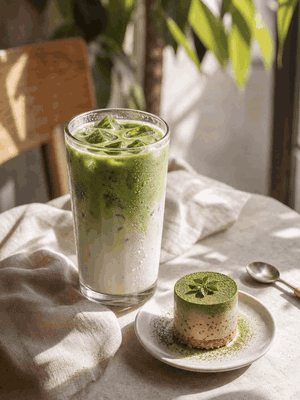

# Food Close-Up Video



*Example from LumiYing*

```text
Subject: a slice of pizza being lifted from a pan.
Input type: text-to-video or start frame.
Camera movement: close-up, slow push-in.
Motion description: melted cheese stretches as the slice lifts; steam rises.
Style: warm tungsten light, dark rustic background, appetizing.
Duration: 5 seconds.
Aspect ratio: 4:5 or 9:16.
Preservation constraints: keep toppings consistent through the lift.
Negative constraints: no toppings appearing or disappearing, no plastic-looking cheese, no utensil warping.
Evaluation notes: check texture realism, steam, and whether toppings stay consistent.
```

## Tip

Steam, pouring, and drizzling read well in short clips. Cutting and chewing usually do not.
