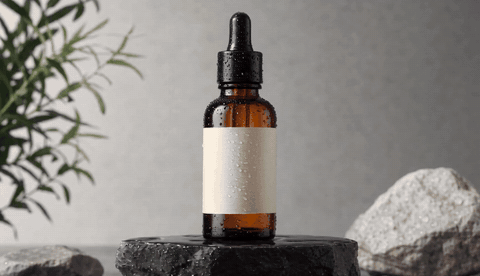

# Hero Rotate Product Video



*Example from LumiYing*

```text
Subject: [product] on a glossy black pedestal.
Input type: start frame / product image.
Camera movement: locked off, slight push-in in the last second.
Motion description: the product rotates slowly 360 degrees on the pedestal; reflections move with it.
Style: premium commercial, studio lighting, dark gradient background.
Duration: 5 seconds.
Aspect ratio: 1:1.
Preservation constraints: keep the product shape, logo, color, and proportions unchanged through the rotation.
Negative constraints: no extra objects, no logo warping on the back side, no wobbling pedestal.
Evaluation notes: check the back of the product (models often invent it), logo stability, and rotation speed.
```

## Tip

If the back of the product matters, use a start and end frame (front and back photos) where the model supports it. A full 360 from one front photo forces the model to guess.
